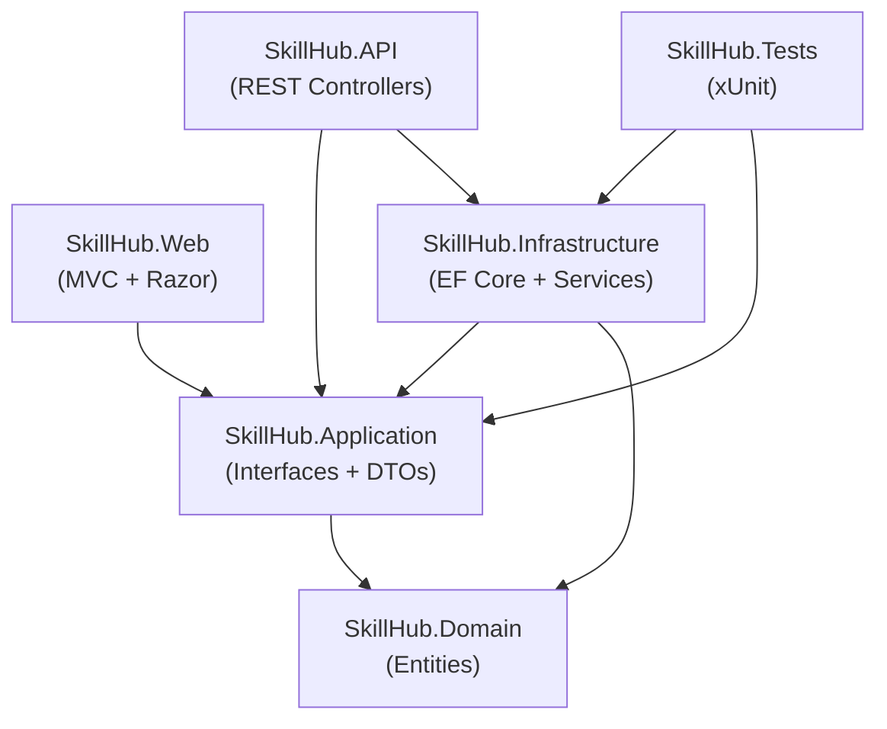

# SkillHub

**SkillHub** is a professional workshop and training management platform built with ASP.NET Core .NET 10. It allows participants to browse workshops, enroll in them, and manage their enrollments, while employees can manage the workshop catalog. A fully documented REST API is exposed via Swagger UI.

---

## Table of Contents

- [Overview](#overview)
- [Architecture](#architecture)
- [Project Structure](#project-structure)
- [Technologies](#technologies)
- [API Endpoints](#api-endpoints)
- [Frontend Pages](#frontend-pages)
- [Getting Started](#getting-started)
- [Running the Tests](#running-the-tests)

---

## Overview

SkillHub provides two interfaces over the same backend:

| Interface | Description |
|-----------|-------------|
| **SkillHub.API** | RESTful JSON API secured with JWT Bearer tokens |
| **SkillHub.Web** | Server-rendered web UI built with ASP.NET Core MVC and Razor Views |

Both projects share the same business logic and data layer through a clean layered architecture.

---

## Architecture

SkillHub follows a **layered (N-Tier) architecture** with strict dependency rules — outer layers depend on inner layers, never the reverse.

```
┌──────────────────────────────────────────────────┐
│                 Presentation Layer                │
│          SkillHub.API   │   SkillHub.Web          │
├──────────────────────────────────────────────────┤
│               Application Layer                  │
│  Interfaces (IAuthService, IWorkshopService,     │
│  IEnrollmentService) · DTOs · Business Rules     │
├──────────────────────────────────────────────────┤
│               Infrastructure Layer               │
│  EF Core DbContext · Identity · Service Impls    │
│  Npgsql (PostgreSQL) · JWT Generation            │
├──────────────────────────────────────────────────┤
│                  Domain Layer                    │
│  Entities: Workshop · Enrollment · ApplicationUser│
└──────────────────────────────────────────────────┘
```

### Dependency Flow



> [!IMPORTANT]
> `SkillHub.Web` calls `SkillHub.API` over HTTP using a named `HttpClient` — it does **not** reference the API project directly. This keeps the frontend decoupled and allows independent deployment.

---

## Project Structure

```
SkillHub/
├── SkillHub.Domain/            # Core entities (no external dependencies)
│   └── Entities/
│       ├── Workshop.cs
│       ├── Enrollment.cs
│       └── ApplicationUser.cs
│
├── SkillHub.Application/       # Business interfaces and DTOs
│   ├── Interfaces/
│   │   ├── IAuthService.cs
│   │   ├── IWorkshopService.cs
│   │   └── IEnrollmentService.cs
│   └── DTOs/
│       ├── Auth/               # LoginRequest, RegisterRequest, AuthResponse
│       ├── Workshops/          # WorkshopResponse, CreateWorkshopRequest
│       └── Enrollments/        # EnrollmentResponse, CreateEnrollmentRequest
│
├── SkillHub.Infrastructure/    # EF Core, Identity, service implementations
│   ├── Persistence/
│   │   └── ApplicationDbContext.cs
│   ├── Identity/
│   │   └── IdentitySeeder.cs
│   └── Services/
│       ├── AuthService.cs
│       ├── WorkshopService.cs
│       └── EnrollmentService.cs
│
├── SkillHub.API/               # REST API (JWT-secured)
│   ├── Controllers/
│   │   ├── AuthController.cs
│   │   ├── WorkshopsController.cs
│   │   └── EnrollmentsController.cs
│   └── Program.cs              # Swagger, JWT auth, DI setup
│
├── SkillHub.Web/               # MVC Web UI (calls API via HttpClient)
│   ├── Controllers/
│   │   ├── HomeController.cs
│   │   ├── AccountController.cs
│   │   ├── WorkshopsController.cs
│   │   └── EnrollmentsController.cs
│   ├── Models/
│   │   └── WorkshopViewModel.cs  # WorkshopViewModel, EnrollmentViewModel,
│   │                               LoginViewModel, RegisterViewModel
│   ├── Views/
│   │   ├── Home/Index.cshtml
│   │   ├── Account/Login.cshtml
│   │   ├── Account/Register.cshtml
│   │   ├── Workshops/Index.cshtml
│   │   ├── Workshops/Details.cshtml
│   │   └── Enrollments/Index.cshtml
│   └── Program.cs
│
└── SkillHub.Tests/             # xUnit integration tests
    └── EnrollmentServiceTests.cs
```

---

## Technologies

### Runtime & Framework

| Technology | Version | Purpose |
|-----------|---------|---------|
| **.NET** | 10.0 | Target framework for all projects |
| **ASP.NET Core MVC** | 10.0 | Web UI (Razor Views) |
| **ASP.NET Core Web API** | 10.0 | REST API with JSON responses |

### Data & ORM

| Technology | Version | Purpose |
|-----------|---------|---------|
| **Entity Framework Core** | 10.0.14 | ORM and migrations |
| **Npgsql.EF Core** | (latest compatible) | PostgreSQL driver for EF Core |
| **PostgreSQL** | — | Primary relational database |

### Authentication & Security

| Technology | Version | Purpose |
|-----------|---------|---------|
| **ASP.NET Core Identity** | 10.0 | User management, password hashing, roles |
| **JWT Bearer** (`Microsoft.AspNetCore.Authentication.JwtBearer`) | 10.0.0 | Stateless token-based auth for the API |
| **System.IdentityModel.Tokens.Jwt** | — | JWT generation and validation |

### API Documentation

| Technology | Version | Purpose |
|-----------|---------|---------|
| **Swashbuckle.AspNetCore** | 6.5.0 | Swagger UI + OpenAPI 3.0 spec generation |

### Frontend

| Technology | Purpose |
|-----------|---------|
| **Razor Views (.cshtml)** | Server-side HTML rendering |
| **Bootstrap 5** | Responsive layout and UI components |
| **jQuery** | DOM manipulation and form validation |
| **jQuery Validation Unobtrusive** | Client-side form validation |
| **HttpClient (named client)** | Web project consumes the API over HTTP |
| **ASP.NET Core Session** | Stores JWT token server-side per user |

### Testing

| Technology | Purpose |
|-----------|---------|
| **xUnit** | Unit/integration test framework |
| **coverlet** | Code coverage collection |

---

## API Endpoints

Base URL: `https://localhost:<port>/api/v1`

### Authentication

| Method | Route | Auth | Description |
|--------|-------|------|-------------|
| `POST` | `/auth/register` | Public | Register a new participant account |
| `POST` | `/auth/login` | Public | Login and receive a JWT token |

**Login response:**
```json
{
  "userId": "...",
  "fullName": "Jane Doe",
  "email": "jane@example.com",
  "role": "Participant",
  "token": "<JWT>",
  "expiresAt": "2026-10-28T..."
}
```

### Workshops

| Method | Route | Auth | Description |
|--------|-------|------|-------------|
| `GET` | `/workshops` | Public | List all workshops with availability |
| `GET` | `/workshops/{id}` | Public | Get a single workshop by ID |
| `POST` | `/workshops` | Employee only | Create a new workshop |

### Enrollments

| Method | Route | Auth | Description |
|--------|-------|------|-------------|
| `POST` | `/enrollments` | Participant | Enroll in a workshop |
| `GET` | `/enrollments/mine` | Participant | List my enrollments |
| `DELETE` | `/enrollments/{enrollmentId}` | Participant | Cancel an enrollment |

> [!NOTE]
> All `Enrollment` endpoints require a valid JWT with the `Participant` role. Include the token as `Authorization: Bearer <token>`.

---

## Frontend Pages

| URL | Page | Auth Required |
|-----|------|--------------|
| `/` | Home — platform overview | No |
| `/Workshops` | Workshop catalog (cards) | No |
| `/Workshops/Details/{id}` | Workshop detail + enroll button | Enroll requires login |
| `/Enrollments` | My enrollments + cancel | Yes |
| `/Account/Login` | Login form | No |
| `/Account/Register` | Registration form | No |

---

## Getting Started

### Prerequisites

- [.NET 10 SDK](https://dotnet.microsoft.com/download)
- PostgreSQL server running locally (or configured via connection string)

### Configuration

Set the following in `SkillHub.API/appsettings.json` (or via environment variables):

```json
{
  "ConnectionStrings": {
    "DefaultConnection": "Host=localhost;Database=skillhub;Username=your_user;Password=your_password"
  },
  "Jwt": {
    "Key": "your-super-secret-key-at-least-32-chars"
  }
}
```

Set the API base URL for the Web project in `SkillHub.Web/appsettings.json`:

```json
{
  "ApiBaseUrl": "https://localhost:5000/"
}
```

Optional — seed an employee account on first run:

```bash
export SKILLHUB_EMPLOYEE_EMAIL=admin@skillhub.com
export SKILLHUB_EMPLOYEE_PASSWORD=Admin@1234
export SKILLHUB_EMPLOYEE_NAME="Admin User"
```

### Run the API

```bash
export ASPNETCORE_ENVIRONMENT=Development
dotnet run --project SkillHub.API/SkillHub.API.csproj
```

Swagger UI will be available at: **`https://localhost:<port>/swagger`**

### Run the Web UI

Open a second terminal:

```bash
dotnet run --project SkillHub.Web/SkillHub.Web.csproj
```

The web application will be available at: **`https://localhost:<port>`**

---

## Running the Tests

```bash
dotnet test SkillHub.Tests/SkillHub.Tests.csproj
```

> [!IMPORTANT]
> One test (`CreateAsync_WithValidData_CreatesActiveEnrollment`) requires a real PostgreSQL database. Set the `SKILLHUB_TEST_CONNECTION` environment variable before running it:
>
> ```bash
> export SKILLHUB_TEST_CONNECTION="Host=localhost;Database=skillhub_test;Username=...;Password=..."
> dotnet test SkillHub.Tests/SkillHub.Tests.csproj
> ```
>
> The other 3 tests run without a database connection and pass without any configuration.

---

## Build

```bash
dotnet restore SkillHub.slnx
dotnet build SkillHub.slnx
```

Expected output: **`Build succeeded. 0 Error(s)`**
